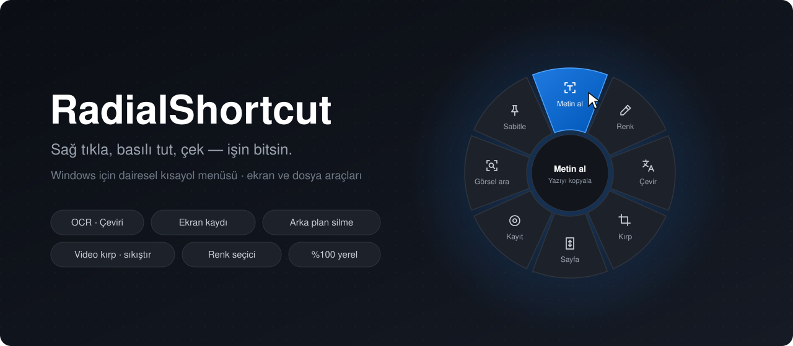
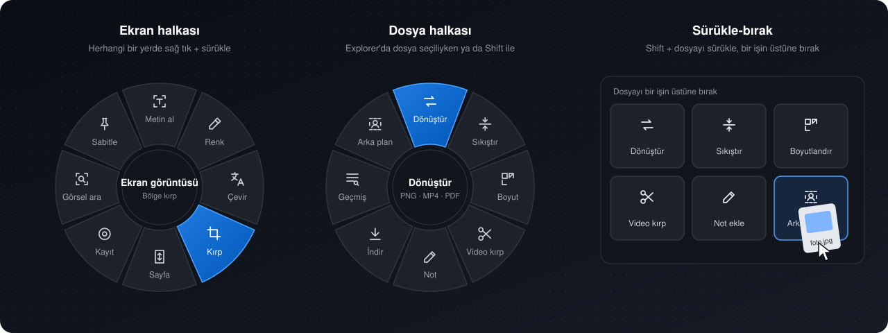

<p align="center">
  
</p>

<p align="center">
  <a href="https://github.com/arrdakaya/RadialShortcut/releases/latest/download/RadialShortcut-win-x64.zip"></a>
  <a href="https://github.com/arrdakaya/RadialShortcut/releases/latest"></a>
  
</p>

<p align="center">
  <b>Windows için dairesel kısayol menüsü.</b> Sağ tuşa basılı tutup fareyi biraz çek:
  imlecin etrafında bir halka açılır, istediğin dilime bırak, iş biter.<br>
  Ekrandan metin almak, çevirmek, kayıt almak, dosya dönüştürmek, arka plan silmek… hepsi bir hareket uzağında.
</p>

---

## Nasıl çalışır

<p align="center">
  
</p>

| Hareket | Ne olur |
| --- | --- |
| **Sağ tık + sürükle** | Ekran halkası açılır. Dilimin üstünde bırak, araç çalışır. |
| **Explorer'da dosya seçiliyken** sağ tık + sürükle | Dosya halkası açılır; araç seçili dosyalarla çalışır. |
| **Shift** + sağ tık + sürükle | Diğer halkaya geçer. |
| **Shift** + dosyayı sürükle | İmlecin yanında iş alanları açılır; dosyayı birinin üstüne bırak. |
| **Ctrl + Alt + Space** | Halkayı klavyeyle açar (basılı tut, bırakınca seçer). |

Normal sağ tık her zamanki gibi çalışır: halka yalnızca fareyi basılıyken çektiğinde açılır.
Oyunlarda ve tam ekran pencerelerde halka hiç çıkmaz.

## Araçlar

### 🖥️ Ekran halkası

| | Araç | |
| --- | --- | --- |
| 🔤 | **Metin al** | Ekrandan bir bölge seç, içindeki yazı panoya kopyalanır (Windows OCR, çevrimdışı). |
| 🎨 | **Renk seç** | Büyüteçle piksel seç; HEX, RGB, HSL olarak kopyala. |
| 🌐 | **Çevir** | Bölgedeki yazıyı okur ve bir kartta çevirir; tarayıcı açmaz. |
| ✂️ | **Ekran görüntüsü** | Bölge kırp, panoya ve klasöre kaydet. |
| 📜 | **Tam sayfa** | Kaydırarak uzun sayfanın tamamını tek görüntüde al. |
| ⏺️ | **Ekran kaydı** | Bir bölgeyi MP4 olarak kaydet. |
| 🔎 | **Görselle ara** | Seçtiğin bölgeyi Google Lens'te ara. |
| 📌 | **Sabitle** | Bölgeyi her şeyin üstünde duran, yakınlaştırılabilir bir pencereye sabitle. |

### 📁 Dosya halkası

| | Araç | |
| --- | --- | --- |
| 🔁 | **Dönüştür** | PNG ↔ JPG ↔ WEBP, video → MP4/GIF/MP3, resimler → PDF, PDF → resimler. |
| 🗜️ | **Sıkıştır** | Resim, video ve ses dosyalarını küçült. |
| 📐 | **Boyutlandır** | %50, 1080p, 720p… |
| 🎬 | **Video kırp** | Başlangıç ve bitişi seç, yeniden kodlamadan kes. |
| ✏️ | **Not ekle** | Ok, kutu, yazı ve bulanıklaştırma ile resim üstüne not al. |
| ⬇️ | **Linkten indir** | Panodaki linkten video ya da MP3 indir (yt-dlp). |
| 🗂️ | **Kütüphane** | Ürettiğin her şeyin aranabilir geçmişi. |
| 🪄 | **Arka planı sil** | Yapay zekâ modeli bilgisayarında çalışır, şeffaf PNG üretir. |

## Gizlilik

Her şey **senin bilgisayarında** çalışır. OCR Windows'un kendi motorunu kullanır, arka plan silme
yerel bir ONNX modelidir. Hesap, takip ya da telemetri yoktur. İnternete yalnızca şunlar için çıkılır:
çeviri, Google Lens, linkten indirme, güncelleme denetimi ve araçların ilk kullanımda bir kez
indirilmesi (ffmpeg, yt-dlp, model; hepsi SHA-256 ile doğrulanır).

## Kurulum

1. **[RadialShortcut-win-x64.zip](https://github.com/arrdakaya/RadialShortcut/releases/latest/download/RadialShortcut-win-x64.zip)** dosyasını indir.
2. İstediğin bir klasöre çıkar ve `RadialShortcut.exe`'yi çalıştır. Kurulum gerekmez, .NET de gerekmez.
3. Simge sistem tepsisine yerleşir. Oradan Windows'la başlatmayı açabilir, kütüphaneyi açabilir, güncelleyebilirsin.

> Windows SmartScreen "tanınmayan uygulama" uyarısı verebilir: **Ek bilgi → Yine de çalıştır**.
> Uygulama henüz imzalı değil.

Güncellemeler GitHub sürümlerinden kendiliğinden denetlenir. Yeni sürüm çıkınca tepsi menüsünde
**Güncelle** belirir; indirilen paket doğrulanır, eski sürüm yedek olarak saklanır.

## Ayarlar

Ayarlar `%AppData%\RadialShortcut\config.json` dosyasındadır, kaydettiğin anda uygulanır.
Örnek dosya ilk açılışta yanına yazılır. Neleri değiştirebilirsin:

- **Halkalar:** uygulamaya ya da pencere başlığına özel dilimler. Örneğin tarayıcıda farklı, VS Code'da farklı bir halka.
- **Kendi eylemlerin:** tuş kombinasyonu gönder, program ya da link aç.
- **Klavye kısayolu**, **tema** (`system` / `dark` / `light`), halkanın çıkmayacağı programlar.
- **DeepL anahtarı:** çeviriyi DeepL ile yapmak istersen.

Kaydedilen dosyalar `Belgeler\RadialShortcut\` altında, **Resimler** ve **Videolar** klasörlerinde toplanır.

## Kaynaktan derleme

```powershell
git clone https://github.com/arrdakaya/RadialShortcut.git
cd RadialShortcut
dotnet test
dotnet publish src/RadialShortcut.App -c Release -r win-x64 --self-contained -o publish
```

Gerekenler: Windows 10 (19041) ya da üstü, [.NET 10 SDK](https://dotnet.microsoft.com/download).

| Proje | İçerik |
| --- | --- |
| `RadialShortcut.Core` | Halka tanımları, ayarlar, geçmiş. Arayüzden bağımsız, testli. |
| `RadialShortcut.Input` | Düşük seviyeli fare kancası ve hareket algılama. |
| `RadialShortcut.App` | WPF halka, sonuç kartları ve tüm araçlar. |

---

<p align="center"><sub>Windows için, Türkiye'den ❤️ ile.</sub></p>
