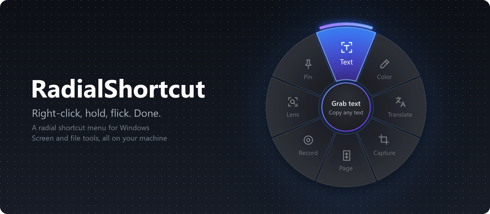
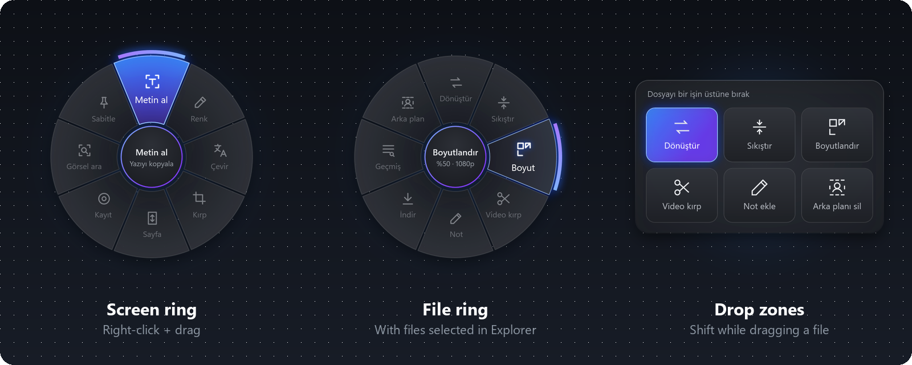

  

  
  
  

  Hold the right mouse button and flick: a ring opens around the cursor. 
  Release over a slice to grab text from the screen, translate it, record a clip, convert a file or remove a background.

  

## Features

**Screen tools**
- **Grab text** from anything on screen (OCR) and copy it
- **Translate** a region of the screen
- **Screenshot**, **full-page scrolling capture** and **screen recording** to MP4
- **Color picker** with HEX, RGB and HSL
- **Search by image** with Google Lens
- **Pin** a capture on top of everything

**File tools**
- **Convert** images, video, audio and PDF
- **Compress** and **resize**, with size estimates before you pick
- **Trim video**, **annotate** images, **remove backgrounds**
- **Download** video or audio from a link
- **Unlock** a file by closing whatever holds it
- A **library** of everything you've captured and made

**Made to stay out of the way**
- A plain right-click still works as usual
- Rings for specific apps, and slices of your own: open apps, links, shortcuts or text
- English and Turkish, light and dark themes
- Everything runs on your machine; nothing is sent anywhere unless you ask

## Install

Download **[RadialShortcut-Setup.exe](https://github.com/arrdakaya/RadialShortcut/releases/latest/download/RadialShortcut-Setup.exe)** and run it. No admin rights needed. RadialShortcut lives in the tray, can start with Windows and updates itself.

Requires Windows 10 (version 2004) or Windows 11, 64-bit.

## How to use

| Gesture | Opens |
| --- | --- |
| Right-click + drag | Screen ring |
| Right-click + drag with files selected in Explorer | File ring |
| Shift or Ctrl while the ring is open | File ring or app ring |
| Drag a file and pause | Drop zones: drop the file on a tool |
| Ctrl + Alt + Space | Ring from the keyboard, for touchpads |

## License

[MIT](LICENSE)
